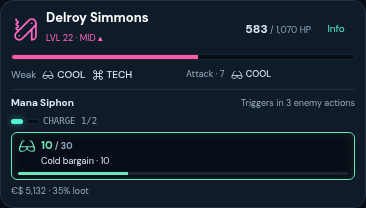

# Dungeon — v1.9.0

Branch: `Dungeon_Focus`. Offline match-three encounters linked to missions, with 43 opponents and a permanent 1,400-HP maximum.

## Health, recovery and Stim Fatigue

New players start at **1,400 HP**. All temporary maximum-HP bonuses have been removed, including High-tier bonuses. Health carries between encounters.

Each encounter has a **1,300-HP recovery budget**, shared by all non-mission healing: Field Patch, Stim objects and victory recovery. Only HP actually restored consumes the budget; attempted healing at full health does not. At 1,300 used, the player card displays **Stim Fatigue · Mission healing only**. The next encounter resets that budget.

Mission XP always restores HP at 1:1, capped at 1,400. It bypasses the encounter budget, never consumes it and remains available during Stim Fatigue. At zero HP the player cannot act; missions can revive them to continue the saved fight, provided its deadline has not passed.

Wins attempt to restore 300 HP, or 150 if an unfinished extended mission is at least 14 elapsed days beyond its original deadline. The actual amount is limited by available health capacity and the remaining recovery budget. A once-per-local-day popup lists qualifying missions. No enemy grants a separate maximum-HP or free-healing bonus.

Deck Vitals reflects health in six phases. A separate overdue-mission count turns yellow at two and red at three or more.

## Seven-day deadline

Every encounter starts a persisted **seven-day wall-clock timer**, including time while the app is closed or the player is defeated. A countdown and local deadline appear beneath the enemy card.

At the deadline the encounter is lost, its win streak resets and no rewards are awarded. Combat and mission revival cannot resume an expired fight. Find another opponent to begin a new seven-day encounter with a new healing budget; current HP carries over. Missions can still heal the player outside combat.

Existing v1.4 fights receive seven days from their first upgrade because previous versions did not record an encounter start timestamp. Existing normal-health deficits are preserved when increasing the old base to 1,400 (+600 current HP, capped at 1,400); zero HP stays zero. Previously bonus-buffed health is clamped to the new maximum. Enemy health, board, mana, missions, currency and inventory are preserved. Old log text remains readable; only actions recorded after this update have replays.

## Entry and circuits

Dungeon requires five distinct top-level Attributes: TECH, BODY, INTELLIGENCE, COOL and OPERATING SYSTEM. Config can map each circuit to another Attribute name. Name matching ignores case and surrounding spaces; duplicate names and Skills cannot satisfy a link. Missing links show instructions without deleting the fight.

The shared 8×8 grid contains Strike plus five Attribute circuits, Wildcards and occasional special objects. Tap adjacent circuits, swipe or use arrows and Enter. Invalid swaps use no turn. Cascades resolve fully. Four in a line normally grants another turn; five or more also creates a Wildcard. Swap a Wildcard with any regular type, including Strike, to clear that type; swap two Wildcards to clear the board. Dead boards automatically regenerate, losing existing Wildcards but preserving health and mana.

Strike is **28 damage per cleared gem**, for both sides, unaffected by Attribute/enemy levels. Player matches of an enemy's weak Attribute add **7 damage per gem**. Endurance in the original roster maps to BODY; Perception maps to OPERATING SYSTEM. Non-weak Attributes grant mana without direct damage. Every enemy has designated **attack circuits** that deal **7 damage per cleared gem** to the player, the same quarter-Strike rule as player weakness damage. Low and Mid enemies have one attack Attribute; High enemies have two. The channels are visible in compact and full cards. They are additional damage sources, not changes to the five permanent player Attributes. Only the selected channels hurt; other enemy Attribute matches just collect usable mana.

Each cleared Attribute circuit supplies one combat mana, up to 30 per pool, including cascades and row/column clears. Players collect all five channels; enemies collect only channels used by their assigned abilities. Strike and Wildcard have no mana pool. Combat mana is separate from permanent Attribute XP; combat grants no character/Attribute XP.

## Player abilities

Tap the corresponding Attribute beneath player health to inspect or activate an ability. Opening an explanation or canceling targeting costs nothing.

| Attribute | Ability | Cost | Effect |
|---|---|---:|---|
| TECH | Overclock | 10 | Deal 65 damage. Against a TECH-weak enemy **or a robot**, deal 100 instead, with a 15% critical chance for 150. Also halve every enemy mana pool, rounding down. Ends the turn. |
| BODY | Field Patch | 12 | Enter a **three-swap sequence**, healing **10 HP per destroyed circuit**, subject to the recovery budget and maximum HP. **No mana is gained. Only Strikes damage the enemy, at half strength: 14 per gem.** Activation does not consume a swap. |
| INTELLIGENCE | Recompile | 10 | Choose a row or column, then a cell. Destroy that line and resolve cascades. Collect all destroyed Attribute mana up to pool caps; Strikes deal 28 each and weakness circuits deal 7 each. Retain the turn if the selected line contains four of one regular color, even nonadjacent, or a cascade matches four. |
| COOL | Cloak | 10 | Reduce damage by 50% for the next **two enemy actions**. Each damaging action reflects **25 + actual HP lost after reduction** to the enemy. Ends the turn. |
| OPERATING SYSTEM | Wildcard Forge | 18 | Convert a selected non-Wildcard circuit into a Wildcard and keep the turn. |

Field Patch counts only valid swaps. Invalid swaps consume no play. Other abilities are unavailable until its sequence ends. Four/five matches can still produce Wildcards but do not add more plays. After the third swap, control passes to the enemy regardless of ordinary extra-turn matches. A double-Wildcard wipe counts all 64 cleared cells, plus resulting cascade clears, for healing, then immediately ends the sequence even with unused plays. Each cleared cell—including a destroyed Wildcard—counts once per cascade frame. Stim Fatigue prevents recovery but does not prevent the three swaps or their half-strength Strike damage. The no-mana/Strike-only/half-damage restrictions apply only during Field Patch. Normal player mana and weakness damage resume after its sequence ends. Visible mines can still hurt the player during Field Patch, and Cloak can still reflect those hits.

Cloak lasts through two enemy actions, including extra-turn swaps and zero-damage abilities. It decrements once per normal enemy action, not per cleared gem. Free talent casts do not consume Cloak duration. Mines triggered during a player action can also be reduced and reflected without consuming an enemy-action duration. Reduction rounds up, then reflection uses the actual HP lost (not overkill damage). Reflection is direct damage, can defeat the enemy and does not recursively reflect or consume enemy protection. If both combatants reach zero from the same protected hit/reflection, the reflection victory resolves first; normal capped victory recovery then applies. Enemy shield abilities retain their separate 75% one-damaging-action protection.

Mister Gutsy, Protectron and Assaultron qualify as robots. A human who works with robots is not automatically a robot, though TECH weakness independently qualifies them for enhanced Overclock damage.

## Encounters, AI and rewards

| Tier | Normal odds | After 5 consecutive wins | Abilities | Crit chance per damaging action | Item-drop chance |
|---|---:|---:|---:|---:|---:|
| Low | 60% | 55% | 1 | 0% | 0% |
| Mid | 30% | 30% | 1 | 15% | 35% |
| High | 10% | 15% | 2 | 20% | 65% |

An opponent is drawn uniformly within the rolled tier. The High chance rises by 50% relative (10% to 15%) after five consecutive victories, remaining active until a loss/expiry. Repeated opponents are possible. Levels identify HP/reward difficulty, not Strike damage.

The original 35 named enemies and the eight added encounters retain their levels/rewards. Creature additions are Radroach, Mole Rat, Mongrel, Yao Guai, Mister Gutsy, Protectron, Assaultron and Deathclaw. HP ranges 335–1,525; currency rewards range €$500–8,000. There is no campaign endpoint.

Every tier now uses tactical search; Low opponents no longer choose random moves. All legal swaps and charged abilities are evaluated for damage, healing, mana/ability readiness, extra turns, Mine self-damage, Mystery activation, turret ownership/destruction, shields and Cloak. The best candidates are searched against player replies, including abilities and follow-up extra actions. Higher tiers inspect more candidate replies and use more independent refill/outcome samples. Minefield placement also preserves legal moves and considers the immediate board threats.

The AI uses the same immutable objects, cumulative fuses and simultaneous group resolver as live combat. It can deliberately leave a dangerous Mine for the player, avoid exploding one on itself, clear one safely, or trigger a beneficial Mystery group. It has no access to actual future refills/outcomes: its simulation seeds come from the visible board, independently of saved combat RNG. Planning neither consumes RNG nor alters combat state. Unknown outcomes can still defeat a reasonable plan. A 43-loadout desktop benchmark averaged about 21 ms per decision (57 ms maximum); physical-phone timing remains unmeasured. Enemy active abilities never directly grant healing; Stim objects remain available to either activator.

Enemy criticals multiply damage by 1.5, rounded to the nearest integer, before protection. Enhanced Overclock has its own 15% player critical chance; regular player attacks do not otherwise crit.

Successful item rolls choose uniformly among currently stocked Exchange items and add one to inventory, consuming finite stock without spending currency, changing prices or incrementing purchase counts. Empty stock means no item. Currency and eligible victory healing are awarded independently of drops.

## Cripple

A successful normal **Strike hit** has a **15%** chance to inflict cripple on its opponent. A successful **critical hit**, including a critical ability, uses **30%** instead. Critical damage remains ×1.5; a critical is not a guaranteed cripple and does not cripple its own attacker. Noncritical Attribute-only or passive/self-hits do not roll cripple. Completely blocked/zero-HP-loss hits do not roll it either.

Cripple randomly chooses one of Strike or the five Attribute types. The target cannot swap either endpoint of that type for its **next normal action**. Those pieces remain matchable/clearable indirectly. The card names the disabled type; pieces show a lock marker, and the player receives a brief message. A paid ability can be used instead of swapping and ends the disable normally. If no legal swap remains, an explicit pass button clears that locked action; the AI can also pass. An extra-turn action still consumes its actor's one-action disable. Free talents never consume it.

## Mystery objects, Mines and Turrets

New boards/refills have **4% Mystery / 96% regular circuits**, with **no random Mines**. Mines only come from Minefield or Mine Kits. Special objects remain immovable; normal circuits can be matched around them.

Mystery circuits have **4 shared health**: each row fallen and each orthogonally adjacent circuit destroyed removes 1. Diagonal clears do not count. Several adjacent clears in the same batch each count once. A horizontal/vertical line of 3+ Mysteries still activates as a group before gravity. Every group member reveals, and group Grenades cannot erase unprocessed members. Direct area clears still remove unrevealed Mysteries. The corner shows remaining health.

| Reveal | Weight | Behavior |
|---|---:|---|
| Grenade | 2 | Clear the surrounding 3×3; normal damage/mana rules apply, and the turn ends even with a four-match. |
| Mine Kit | 2 | Before the action ends, the activator chooses a regular circuit to replace with a Mine. No mana is earned from replacing it. |
| Turret | 1 | Owner's normal actions fire for 25 base damage. Shared **2 health** from falls/orthogonal clears. Bottom-row landing/creation destroys it immediately, with no final shot. |
| Machine Gun | 2 | Resolve after Mine Kit/Battery setup: the activator chooses its own row or column, clearing and collecting those circuits and cascades. Full base Strike/weakness damage applies even during Field Patch; armor, shields and Cloak still apply. Its clears never earn an extra turn; a pre-existing extra turn remains unless a Grenade ends it. |
| Battery | 2 | Choose an ability channel. Gain 2 mana to that channel per owner action, capped at 30 and respecting mana locks. Shared **4 health** from falls/orthogonal clears; bottom-row landing/creation destroys it. |

Mystery no longer reveals Stim or Mimic. Old standalone pieces/replays remain readable. Turrets retain half the reveal weight of each other outcome. Choices save immediately and must be resolved before another swap/ability; AI chooses placement, usable mana channel and firing axis. Multiple Machine Guns resolve after other setup choices. Setup choices do not grant separate normal actions or trigger repeated Battery/Turret ticks. A no-moves reshuffle preserves deployed objects and their wear/ownership.

Mines explode after **2 cumulative rows fallen** and damage whoever caused the final drop. Mine Kit Mines deal 30 raw damage; Minefield Mines retain their listed tier damage (20/30/45). Every detonated Mine independently rolls **30% to cripple its mover** for the next action. Direct clears disarm unripe Mines. Mine damage remains separate and respects protection/reflection.

## Strategic enemy abilities and free talents

[All 43 enemy assignments](DUNGEON-LOADOUTS.md) have curated loadouts: **one active ability and one talent** for Low/Mid, **two active abilities and one talent** for High. Their attack circuits are the same channels that charge their abilities. Active abilities spend mana and are board/control effects instead of independent flat-damage attacks:

- **Line clear:** destroy a selected row or column, collect usable mana and apply Strike/attack-circuit damage. Four of one regular color in the line, or a four-match cascade, can retain the turn.
- **Strike conversion:** convert up to 1/2/3 circuits into Strikes (Low/Mid/High), then resolve created matches and cascades.
- **Mana drain:** steal up to 1/2/3 mana from the player's largest pool, then convert one board circuit into an attack circuit.
- **Wildcard disruption:** drain up to 1/2/3 of the player's strongest mana and replace up to 1/2/3 Wildcards with attack circuits. Newly created matches resolve normally.
- **Shield:** block 75% of the next damaging player action and add two own-channel mana.
- **Forge:** create a Wildcard beside a useful circuit and keep the turn. It still costs mana; the AI does not repeatedly forge an already Wildcard-filled board.

Ordinary active abilities cost 8/10/12 mana by tier; Forge costs 8/12/18. Their descriptions and costs appear on the enemy card's Info panel. Line/conversion attacks use the actual destroyed circuits, including cascades and attack Attributes. No old flat-damage ability remains active. Yao Guai's Maul now clears a row; those destroyed circuits actually supply its damage and mana in the same action.

Talents are automatic **free bonus actions**, followed by the enemy's normal move or paid ability. They do not spend mana, heal enemies, advance the enemy-action counter, consume Cloak duration or recursively trigger themselves. The first cast is before normal enemy action three, except Grid Reboot (five). Extra-turn swaps and paid abilities count as normal actions for timing.

| Talent | Effect | Timing after activation |
|---|---|---|
| Minefield | Maintain up to two actual immovable Mines, each dealing 20/30/45 raw damage to whoever causes its second row of falling. Existing Mines retain their fuse progress; a cast fills missing Minefield slots instead of resetting them. Direct clears safely disarm unripe Mines. | Free casts before actions 3, 6, 9… |
| Signal Veil | Random newly generated refill pieces are hidden (20%/35%/50% chance by tier). Existing pieces stay visible; hidden survivors retain their masks when swapped or falling. Masks conceal color, icon and accessible name. | Lasts two player actions. All masks then reveal; only then does the three-full-enemy-action cooldown begin. |
| Strike Overdrive | Next enemy action deals 56 per Strike instead of 28. Attack-Attribute damage stays 7. It expires even if the enemy uses a non-damaging ability. | One enemy action, then three full enemy actions before reactivation. |
| Mana Siphon | Steal 1/2/3 actual stored mana from the player's largest pool and add it to the enemy's primary ability channel, respecting its 30 cap. | Free casts every three normal enemy actions. |
| Reactive Plating | Flat reduction of 8/16/24 damage per incoming player action, before any separate shield. Cannot heal or turn damage negative. | Two player actions, then a three-full-enemy-action cooldown. |
| Mana Lock | Disable collection in the player's strongest mana channel. Other channels and already stored mana remain usable. | One player action for Low/Mid, two for High; then three full enemy actions of cooldown. |
| Countercharge | During a two-player-action window, bank the first actual direct hit as bonus damage, capped at 12/24/40. The next damaging enemy action spends that bonus once; non-damaging moves preserve it. | Three full enemy actions after spending the bonus, or after an unused window expires. |
| Grid Reboot | Replace the grid with a fresh stable/playable board, removing Wildcards. HP, stored mana, deadline and healing budget stay intact. Assigned only to High enemies. | Before actions 5, 10, 15… |

The first three are the requested talents; the remaining five add resource pressure, defense, counterplay and board control. High enemies get stronger tier-scaled effects and two attack channels; Low enemies retain smaller talent values and a narrower tactical search; their moves are still selected strategically. The current enemy card always shows the talent name and active duration/trigger countdown, including compact mode. The grid labels mines visibly and the player card calls out lock/concealment hazards. Inspection costs no turn. Each character’s Info includes only its assigned talent’s specific values. For example, Delroy shows a two-mana Mana Siphon, without unrelated Mine damage, Plating or Countercharge values. The full rules still list all talents as a general reference.

Non-damaging extra actions still count as player actions when expiring player-action effects (for example Wildcard Forge); invalid swaps and canceled dialogs do not. Cooldowns pause while duration-based effects are active. A Field Patch sequence supplies three player actions, so concealment/armor can expire during that sequence.

## Save compatibility

Version 6 saves add per-object Mine/Mystery fall counters. Existing v1.7 fights keep HP, mana, seven-day deadline, healing budget, rewards, currency, cripple and Turrets; existing Mine/Mystery pieces begin with fresh counters. Old cell-marker Minefield traps are retired; subsequent casts place the new physical Mines. If an old board had legal moves only because objects could be swapped, it gets a fresh playable grid while preserving health/resources/deadline. Previously saved action replays keep their original accounting and are flagged as historical; playback can still show the formerly legal object swaps without executing them under the new rules. An authentic v1.7.1 Mystery-swap save is covered by migration tests. Live and replay fuse/event metadata is validated before rendering.

## Combat feedback and playback

The compact enemy card retains visible weaknesses. Player and enemy stat cards stay clean at every health level. Strike rounds now fly from cleared cells into the opposing card, with short glowing impact flashes and shot sounds. The final round arrives with the damage number. Glass cracks, bullet holes and persistent burn overlays remain removed. Damage numbers, brief card shake, original sounds, match bonuses, glowing mana and the active Cloak outline remain. Old cosmetic metadata is accepted for save compatibility but is not rendered, and new actions no longer generate it.

The log includes automatic talent casts and separate mine damage/protection/reflection, as well as actor, damage sources and gem counts, raw damage, criticals, protection, actual HP removed, reflection, healing and mana costs/gains, cripple and separate passive/self-hit sources. The latest player action and latest enemy action are clickable replays. Both are saved across reloads, including a winning action. Playback shows their saved board, counters and effects, then restores the current live screen. It never executes a combat command or changes health, mana, rewards, healing budget, RNG, turns or the encounter deadline. Only the most recent action per side is retained for replay; replays retain up to the resolver’s 100-frame bound, including every activation batch and complete final accounting. No Mystery group is skipped by the old five-frame display cap.

Glowing mana, per-mote mana counters, original synthesized cues and smaller damage numbers remain available. Four-matches explode in bright warm sparks; five-matches explode in rainbow glow. Strike shots hit the target card; passive turret fire has a separate shot and damage entry. The new compact enemy card uses an inline identity/level/HP header, all weakness/attack icons, a separate free-talent timer and short paid ability mana rows. At 390 px width/default type it is about 137–150 px tall across the 43 enemies; Delroy is 137 px compared with 208 px in the former compact view. That former compact view is now Expanded; the old large view has been removed. Both views retain name, original icon, HP, level/tier, every weakness, attack circuit, talent timing, cripple, paid ability names/costs/mana, reward/drop availability and protection. Text can wrap when enlarged. Class/designation and full mapped Attribute names remain in Info. Sounds respect global mute/volume and the Dungeon toggle. Reduced motion omits shake/particles but preserves messages and ordered counters. Leaving Dungeon, hiding the app or opening a dialog pauses future enemy scheduling; the seven-day wall clock continues.

All enemy symbols use the existing Lucide family. [Preview and source credits](ICON-SOURCES.md). Shared icon IDs, uploaded Attribute images and the optional Attribute-icon mapping remain available; Strike and Wildcard always keep their own symbols.

## Enemy card layout preview

| Compact | Expanded (the previous compact view) |
|---|---|
|  |  |

## Validation

Version 1.10.0 (Android code 35) passes 243 automated tests and mobile browser checks for setup choices, save/reload, mission completion and bulk selection/deletion. The new object rules are covered alongside migration and historical replay accounting. Board stress checks resolve pending devices over 3,000 swaps, and a separate 13-loadout combat simulation validates each saved action. The APK uses the existing signing certificate and bundles the same web assets. Physical-device gameplay, audio and performance still need testing.

## Player card and turret retirement (v1.9.0)

The player card defaults to a compact layout: operator name/HP, health bar, vitals, recovery budget, five ability/mana controls and the ability hint. Tap the name to expand or compact; this independent preference persists. Existing icons, statuses, locks, fatigue and ability dialogs remain available, including at enlarged text sizes. Field Patch costs **12 BODY mana**; its healing, three swaps and damage/mana restrictions stay the same.

A Turret dies when it reaches the bottom row, even if it has fallen fewer than three rows. A Turret created there queues one 25-damage shot and disappears. Its removal is part of board resolution: gravity, matches, damage, mana, Mystery activations and Mine fuses all count normally, including cascades caused by the empty cell. The AI models this retirement and its one-shot reward. Historical saved bottom Turrets retire when the board next resolves. Player-card browser checks cover compact/expanded persistence, all controls, 12-point gating, bottom-shot/cascade accounting, replay invariance and 320–430 px layouts at 100–160% text. Physical-phone testing remains pending.

## Charge removal (v1.9.1)

Charge ×2 no longer accumulates, doubles damage/mana, influences AI choices or appears on combat cards, results or rules. Existing live Charge progress is cleared on load without changing health, mana, board, deadlines, rewards or turn. Saved replays retain their originally recorded damage/mana and particle timing; playback never recalculates rewards. Four-match extra turns, five-match Wildcards, criticals, Strike Overdrive and the distinct Countercharge enemy talent retain their existing behavior.

Release verification: all 239 automated tests pass, including both actors’ unchanged base damage/mana with obsolete Charge present, four/five extra turns, legacy-save/replay integrity and AI choices independent of Charge. Mobile browser checks cover both card modes, Rules, normal mana collection, four-match extra turns, ability costs, exact replay state and 320–430 px layouts at 100–160% text.

## Compact player layout correction (v1.9.2)

The player card now follows the supplied compact layout: name/HP on one row, a 4 px bar, close-set vitals and recovery lines and five short ability tiles. Default height at a 390 px viewport is about 165 px, versus 208 px previously. Attribute labels truncate to one line in compact mode; their full names remain in button accessible labels, title tooltips and ability dialogs. Ability names/costs wrap without clipping; larger text can increase card height. Cloak, cripple, Stim Fatigue, Field Patch, mana locks, concealment and Mine warnings remain visible. The independent saved expand/collapse toggle and current combat mechanics are preserved. Mobile browser checks cover both layouts, costs, statuses, state integrity and 320–430 px widths at 100–160% text.

## Player-card hints (v1.9.3)

The Mine-drop warning is removed from the player card in both layouts. Compact mode hides the Attribute-tap hint; expanded mode keeps it. Mine fuse counters, mechanics, active statuses and all five ability controls remain unchanged.

## Special circuit rework (v1.10.0)

Save schema 7 stores devices and mandatory pending setup choices. Older live random Mines become fresh Mystery circuits; Minefield Mines remain. Existing Turret wear is clamped to the new two-health budget. Health, currency, mana, encounter deadlines and historical replay accounting are preserved. Historical replays retain their old results rather than executing new rules.

Mission cards place their selected artwork first, with a small completion circle in the upper-right (completed cards keep a check). That control still opens completion confirmation. Long-press starts multi-selection instead of opening the editor. Tap to mix selections, select visible, cancel or review the named list before deleting. Removing a selected parent releases its surviving children as independent missions. Deletion reschedules reminders through the existing scheduler and never changes already-earned XP/currency. The three-dot editor remains available.

Validation: 243 automated tests, including new reveal weights, shared health, orthogonal adjacency, 30% Mine self-cripple, pending-choice save/reload and malformed metadata, Machine Gun turn/damage rules, Battery mana/caps, blocked-board reshuffles, legacy migration and existing app behavior. Board stress checks resolve setup choices across 3,000 swaps. An additional simulation validated 500+ combat commands and 50+ setup choices over 13 enemy loadouts. Browser checks cover all player setup choices across reload, Mine placement, Battery health, Machine Gun, mobile widths, mission corner completion, actual long-press selection and confirmed bulk deletion. Physical-device play and audio testing remain pending.
