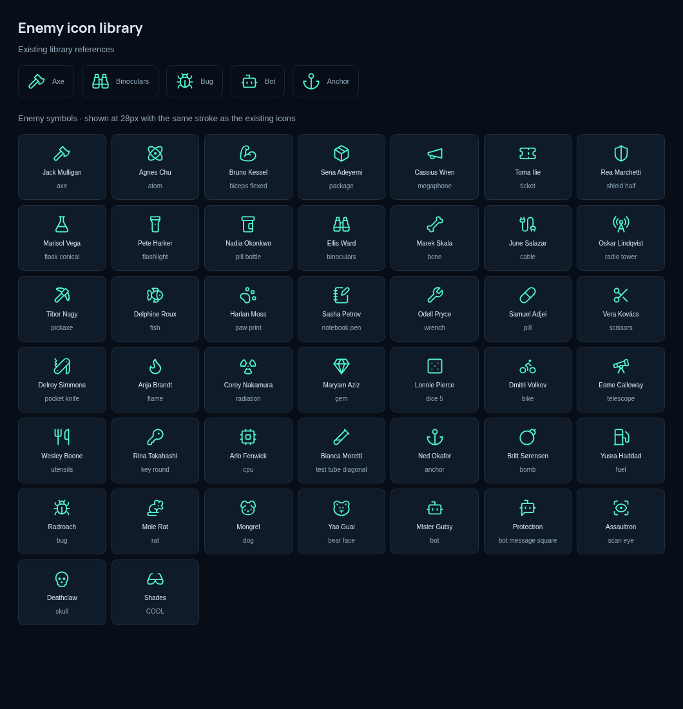

# Enemy icon cleanup — v1.3.1

The custom item drawings and creature silhouettes have been removed. Every enemy now uses one unmodified symbol from the Lucide family already present in Daemon Deck. All 43 opponents have different assigned symbols. The shared renderer supplies the same 24×24 coordinate system, 1.6 stroke width, round caps, round joins and theme color as the existing library.

Examples: Mongrel → Dog; Yao Guai → Bear Face; Radroach → Bug; Mole Rat → Rat; Jack Mulligan → Axe; Nadia Okonkwo → Pill Bottle; Delroy Simmons → Pocket Knife. Robots use simple Bot, Bot Message Square and Scan Eye symbols. Deathclaw uses Skull. COOL uses sunglasses.

Enemy IDs and saved icon selections are unchanged. The picker retains 244 named choices; some enemy assignments intentionally reuse the exact existing library artwork instead of adding another drawing of the same object. Centering and particle-synchronized mana counters remain intact.

## Sources and license

- Standard symbols: [lucide-static 0.468.0](https://www.npmjs.com/package/lucide-static/v/0.468.0), the same package used for the existing 150 Lucide icons.
- Bear Face and Glasses Sun: [Lucide Lab](https://github.com/lucide-icons/lucide-lab/tree/34b6526d0a67bbe67b8a54b9b101018b1377ef28/icons), pinned to commit `34b6526d0a67bbe67b8a54b9b101018b1377ef28`.
- Both use the same ISC license and copyright notice, already bundled in [icons-LICENSE.txt](../dist/icons-LICENSE.txt).

The original SVG bodies are embedded locally in `dist/enemy-icons.js`; they require no network connection. Each entry records its source symbol. No portraits, custom monster faces, decorative overlays or redrawn tool variants are used.
